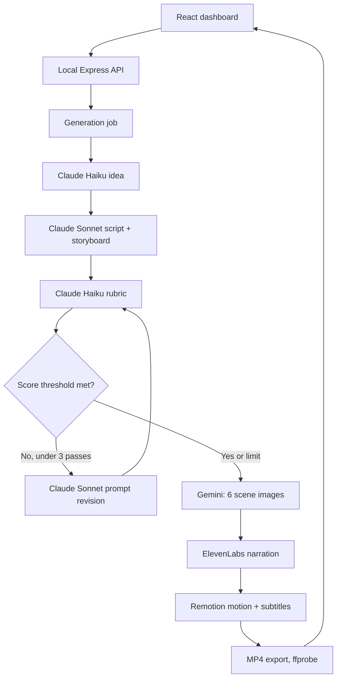

# Module and workflow architecture

Live mode keeps a revision list and preserves the final version, but is an intentionally small test implementation. Image regeneration after revision is performed once at the end from the chosen storyboard; no intermediate versions are rendered and scored. FFmpeg fallback is used only when Remotion fails, unless disabled. Production should split job execution into queues, store source assets and evaluator prompts, and evaluate rendered media with a multimodal model.

## Upgrade sequence

1. Replace in-process tasks + JSON file store with PostgreSQL, Redis/BullMQ and durable worker leases.
2. Add live frame sampling and multimodal evaluation, audio-level checks, and word-level `faster-whisper` alignment.
3. Implement authenticated campaign settings, budget caps, rate limits, cancellation and idempotency.
4. Implement optional Kokoro compatible HTTP TTS as a fallback and add proper voice selection.
5. Add account connections + official Instagram/Facebook/YouTube publishers in a separate module; never publish from the generative worker.
6. Store API usage/token counts and provider invoice totals for per-Reel cost reporting.

## Dependencies and licensing

Remotion's licensing depends on usage and organization; review https://www.remotion.dev/license before commercial deployment. AI model/API contracts also change over time.
